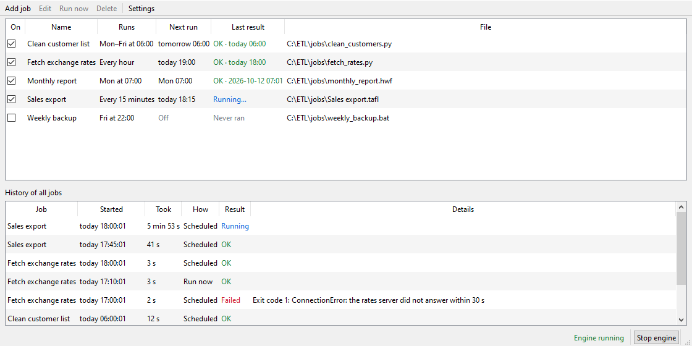

# etlwarden

Pick a file, set a time, and it runs in the background.

etlwarden runs your ETL jobs on a schedule: TAFL projects, Python and Lua scripts, KNIME workflows, Apache Hop workflows and pipelines, and programs or batch files. You choose the file and when it runs in a small window. A background engine does the running and keeps a history, with a log of everything each run printed.



## How it works

Two programs share one job list:

- **The window** (`etlwarden`) is where you add jobs, choose when they run and look at the results. It never runs jobs itself, so you can close it whenever you like.
- **The engine** (`etlwarden engine`) runs in the background without a window. Every 5 seconds it checks the job list, starts what's due, and writes back the result and log of each run.

The job list is a SQLite file in the data folder: `%LOCALAPPDATA%\etlwarden` on Windows, `~/.local/share/etlwarden` on Linux and macOS.

## Install

### Download for Windows (no Python needed)

1. Download `etlwarden-0.1.0-windows-x64.zip` from the [latest release](https://github.com/xv8mna/etlwarden/releases/latest).
2. Unzip it into a folder of your choice, for example `C:\Tools\etlwarden`.
3. Start `etlwarden.exe`.

The program isn't signed with a paid certificate, so Windows may say it protected your PC from an unknown app. Click **More info**, then **Run anyway**. At work, your IT department may have to allow it first.

For the command line, the download has `etlwarden-console.exe`, for example `etlwarden-console status`. Python jobs still need Python installed, and TAFL, Lua, KNIME and Apache Hop jobs need their own programs.

### From the source code

You need Python 3.10 or newer from [python.org](https://www.python.org/downloads/). Get the code with `git clone https://github.com/xv8mna/etlwarden.git`, or download it as a ZIP from GitHub and unpack it. Then, in that folder:

```powershell
python -m venv .venv
.venv\Scripts\python -m pip install -e .
```

Start the window with `.venv\Scripts\etlwarden`. On Linux or macOS, use `.venv/bin/python` and `.venv/bin/etlwarden` instead.

## Use it

1. Open the window.
2. Click **Add job…**, choose the file, pick when it runs, and click OK. To try things out, use `examples/hello.py`.
3. Click **Start engine** at the bottom right.
4. Select the job and click **Run now** to test it. The history shows the result. Double-click a run to see its log.

TAFL projects (`.tafl`) run with `tafl run`, which calculates all tables and writes the exports. When a TAFL run fails, the history names the table, the step and the error. etlwarden finds `tafl.exe` and `lua.exe` on your PATH. If they aren't there, or for KNIME (`knime.exe`) and Apache Hop (`hop-run.bat`), set where the program is under **Settings**.

Python jobs run with the Python you get by typing `python` in a new terminal, so they find the packages you installed there. If a job needs a particular environment, choose its `python.exe` under **Settings**.

## Schedules and safety nets

A job runs either:

- at a time on the days you pick, such as Mon–Fri at 06:00, or
- at an interval from a list, lined up with the clock: every 15 minutes means :00, :15, :30 and :45, and every 6 hours means 00:00, 06:00, 12:00 and 18:00.

Times stay the same when daylight saving time starts or ends.

Each job also has:

- **A time limit.** The engine stops the job, and anything it started, if it runs longer. The default is 60 minutes.
- **Catch-up.** If the computer was off at the run time, the job runs once when it's back. Missing several run times still gives just one catch-up run. You can switch this off per job.

A job never runs twice at the same time. If it's still busy when it's due again, that run is skipped and the history says why. On Windows, jobs also stop together with the engine, even if the engine is ended in Task Manager, so a restarted engine can't run a job a second time alongside it. At most 2 jobs run at once; the rest wait in a queue. You can change that number in **Settings**.

A batch file counts as failed when it ends with a non-zero exit code (ERRORLEVEL). If it uses `exit /b` without a number after an error, the error's code counts.

## Start the engine with Windows

**Start engine** keeps the engine running until you log off or restart. To start it whenever you log on:

1. Press Win+R, type `shell:startup` and press Enter. A folder opens.
2. Right-click in it, choose **New > Shortcut**, and enter this, with the folder changed to where your copy of etlwarden is. Keep the quotes; they matter when the path has spaces.
   - Download: `"C:\Tools\etlwarden\etlwarden.exe" engine`
   - From the source code: `"C:\Tools\etlwarden\.venv\Scripts\pythonw.exe" -m etlwarden engine`
3. Name the shortcut "etlwarden engine".

If an engine is already running, a second one notices and quits, so this can't start your jobs twice.

To keep jobs running while nobody is logged on, for example on a server, use Task Scheduler instead:

1. Open Task Scheduler and choose **Create Task** (not "Create Basic Task").
2. **General:** select "Run whether user is logged on or not".
3. **Triggers:** add one that starts the task "At startup".
4. **Actions:** start the program `C:\Tools\etlwarden\etlwarden.exe` with the arguments `--data-dir C:\etlwarden-data engine`. From the source code, start `C:\Tools\etlwarden\.venv\Scripts\pythonw.exe` with `-m etlwarden --data-dir C:\etlwarden-data engine` instead. Use a data folder that the task's user can write to.
5. **Conditions:** untick "Start the task only if the computer is on AC power".
6. **Settings:** untick "Stop the task if it runs longer than" (by default Windows stops it after 3 days), and tick "If the task fails, restart every 1 minute".

Open the window with the same data folder (`etlwarden.exe --data-dir C:\etlwarden-data`), and check with `etlwarden-console.exe --data-dir C:\etlwarden-data status`. A task that runs while nobody is logged on can't see mapped drive letters such as `Z:`, so give job files and the paths inside jobs as network paths like `\\server\share\...`.

## Command line

With the download, run them as `etlwarden-console ...` in its folder. From the source code, run them in the project folder as `.venv\Scripts\etlwarden ...`, or activate the virtual environment first.

| Command | What it does |
|---|---|
| `etlwarden` | Open the window |
| `etlwarden engine` | Run the engine in this console; Ctrl+C stops it |
| `etlwarden status` | Show whether the engine is running, and the job list |
| `etlwarden --data-dir FOLDER ...` | Use another data folder |

Instead of `--data-dir`, you can set the environment variable `ETLWARDEN_HOME` to a full path. The window and the engine must use the same data folder. Keep it on a local disk, because SQLite doesn't work reliably on network drives.

## Add your own kind of job

Every job type lives in `etlwarden/runners.py`. Each one is a small function that turns the file into a command line. To add one, write a function like `python_command`, add it to `KINDS`, and add its file ending to `SUFFIXES` so the window recognizes it.

## What's in the box

```text
etlwarden/
  app.py        the window (PySide6)
  engine.py     the background engine
  db.py         the job list (SQLite)
  schedule.py   when a job runs next
  runners.py    how each kind of file is started and stopped
  paths.py      where the data folder is
  lock.py       only one engine per data folder
  textfmt.py    times, durations and job output shown to people
  cli.py        the etlwarden command
examples/
  hello.py      a tiny job to try things with
packaging/      how the Windows download is built
tests/          the automated tests (see below)
```

To work on etlwarden itself, install the test tools with `.venv\Scripts\python -m pip install -e ".[dev]"` and run `.venv\Scripts\python -m pytest`. To build the Windows download, install the build tools with `.venv\Scripts\python -m pip install -e ".[build]"` and run `.venv\Scripts\python packaging\build.py`. The zip ends up in `dist`.

## Not there yet

- It has been tested on Windows 10 with Python 3.14. Linux and macOS should work but haven't been tried, and there a job keeps running if the engine is killed hard.
- TAFL jobs have been tried with the real TAFL. The KNIME and Apache Hop commands follow their documentation, and Lua jobs are a plain `lua script.lua`, but none of these three has been tried with a real installation yet.
- Jobs start on a schedule or with Run now. There's no "when a file arrives" or "after another job" yet.
- Nothing notifies you when a job fails. Check the history.
- The window shows the jobs on its own computer. For a server, open it over remote desktop.

## How it was made

etlwarden was built with [Claude](https://claude.com), Anthropic's AI, as a pair-programming partner: I described what I needed, Claude wrote the code, tests and documentation, and I tried it out and decided what went in. Every commit names Claude as co-author.

## License

etlwarden is released under the MIT license; see [LICENSE](LICENSE). It uses PySide6 (Qt for Python) under the LGPLv3, and only its Essentials modules, which avoids Qt's GPL-only add-ons.
